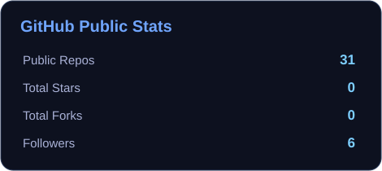
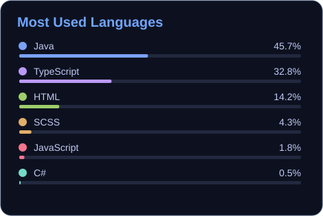

## GITHUB DEVELOPER STATISTICS

## PROGRAMMING LANGUAGES

## MY GITHUB CONTRIBUTIONS

### TECH STACK IN MOTION

### PROJECT STREAM

### CURRENT GITHUB SIGNAL

GitHub statistics are generated automatically using GitHub Actions. Public repository data and contribution metrics are refreshed daily.
